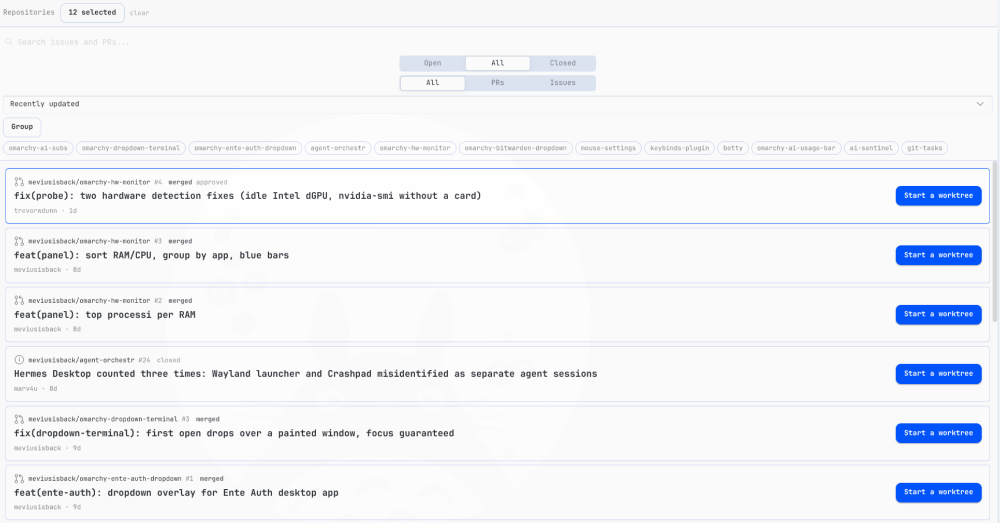

<div align="center">

# git-tasks

**All your GitHub issues and PRs in one Hermes Tasks view — jump into the work with a single click.**



</div>

## Why it exists

The loop is always the same: **read** the queue, **decide** what matters, **delegate** the work. git-tasks keeps all three in one screen inside Hermes Desktop — no hopping between `gh` and the browser, no losing the thread while an agent runs.

| Read | Decide | Delegate |
|---|---|---|
| One list across every followed repo, filterable by state and type | Orca-style detail: meta, body, comments, labels, checks, merge | One button grows a worktree and opens a Hermes session already in context |
| CI dot and live session chip on each card | Review actions (approve, merge, comment, close) without leaving Hermes | Missing clone? The plugin offers to `gh repo clone` it and keeps going |
| Lists refresh automatically, repos load in parallel | Skill prompt seeded into the new session, ready to run | Link any open session manually, or jump straight to it |

## What it does

- **One list for every repo.** Pick which repositories to follow (up to 50); filter by Open / All / Closed and by PRs / Issues. Lists refresh automatically.
- **Orca-style detail.** Click a card to see sections (meta, body, comments, labels, checks, merge) with readable, wrapping text.
- **Start a worktree.** One button creates a git worktree under your local clone and opens a **new Hermes session already working in it**, with the issue/PR in context. If the worktree already exists, the button becomes "Go to worktree".
- **Choose your bot.** Before creating, you pick which profile/bot opens the session and which branch to start from (default branch, `origin/main`, or the PR's branch).
- **Missing clone?** If the repo isn't on disk, the plugin offers to `gh repo clone` it into one of your folders and keeps going.
- **Review actions.** Approve PRs, close/reopen issues and PRs, merge (merge / squash / rebase with confirm), comment — all without leaving Hermes.
- **CI at a glance.** A dot on each PR card: green (checks passing), red (failing), yellow (running).
- **Live session presence.** Cards linked to a session show a status chip (working / waiting for input / idle / ended), refreshed every 10 seconds. A **Go to session** button jumps straight to it; you can also link any open session manually.
- **Skill on start.** Optionally name a skill when creating the worktree — it is pasted into the new session input right after the issue/PR ref, ready to run.
- **Centered setup dialog, manual refresh, parallel loading.** Worktree setup opens in a centered dialog; a refresh button reloads the list on demand; repos load in parallel.

## Install

```sh
./scripts/install.sh
```

Then in Hermes Desktop: `Ctrl+K` → **Reload desktop plugins** → open `/tasks`.

## First run in three steps

1. Open `/tasks` and pick which repositories to follow (up to 50, from your GitHub account or by name).
2. Click any card to read the full detail — body, comments, checks, merge state.
3. Click **Start a worktree**, pick the bot profile and branch, confirm — a Hermes session opens already working in it.

## Requirements

- Hermes Desktop (recent version, `>= 0.21.1` per `plugin.yaml`)
- [`gh` CLI](https://cli.github.com/), authenticated (`gh auth login`) — **or** a GitHub token (see How it works)

## Configuration

`Settings → Plugins → Git Tasks`:

- **Repositories** — which `owner/repo` to follow (up to 50). You can also pick them from your GitHub account inside the plugin.
- **Clone folders** — where your local clones live (`~/repo`, `~/repos`, …). Used to find clones and as the default clone destination.

## How it works

1. Click **Start a worktree** on any card.
2. Pick the bot profile and the starting branch, confirm.
3. The plugin creates `<clone>/.worktrees/<type>-<number>-<slug>` on a new branch and opens a session there with the task in context.
4. Work normally: commit, push, open the PR, merge. Afterwards clean up with `git worktree remove` from the clone.

| Data source | When | Notes |
|---|---|---|
| **Auto** (default) | `gh` answers in the shell, else GitHub API | Switched from the **Data source** button, top-right of the panel |
| **gh CLI only** | You force it | Full detail incl. review-decision dot |
| **GitHub API only** | You force it, or no shell bridge | Token (classic or fine-grained, `repo` scope) lives only in browser plugin storage, travels only as an `Authorization` header to `api.github.com`, never written to the repo or logs. No review-decision dot on cards; worktree creation is delegated to the agent |

Every shell interpolation is quoted, repository names are allowlist-validated, merge methods are allowlisted and always confirmed, external links only open on `https://github.com/`, and third-party issue/PR text is labelled untrusted in seeded agent sessions.

## Contributing

Single-file ESM plugin, no build step:

```sh
node --check desktop/plugin.js   # syntax
npm run test                     # pure-function tests
./scripts/install.sh             # deploy to ~/.hermes/desktop-plugins/git-tasks/
```

## Removal

```sh
rm -rf "${HERMES_HOME:-$HOME/.hermes}/desktop-plugins/git-tasks"
```

Then `Ctrl+K` → **Reload desktop plugins**. Your clones, worktrees and Hermes sessions are untouched.

## License

MIT (declared in `plugin.yaml`).
